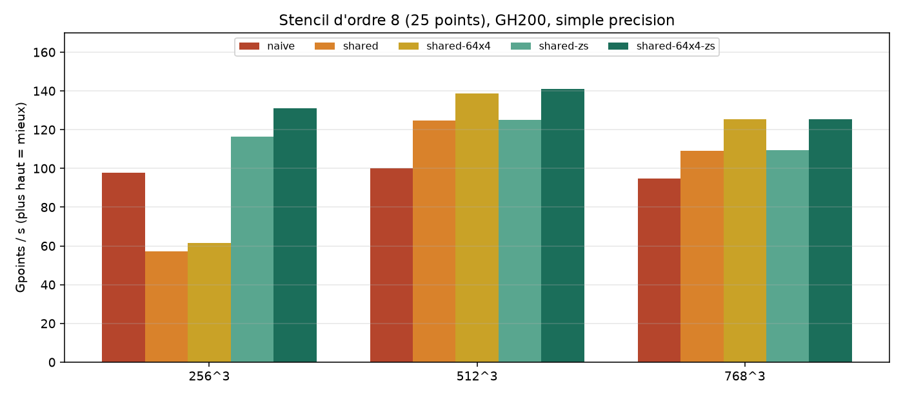

# Stencil sismique d'ordre 8 (noyau de RTM) sur GPU et CPU

La migration par retournement temporel (RTM) passe l'essentiel de son temps dans un seul noyau : la propagation d'une onde acoustique 3D,

```
p(t+dt) = 2 p(t) - p(t-dt) + v² dt² ∇²p(t)
```

avec un Laplacien d'ordre 8 en espace, soit **25 points par mise à jour**. Ce projet optimise ce noyau sur un GPU NVIDIA GH200 et sur le CPU Grace du même nœud (ROMEO), en simple précision et avec un modèle de vitesse à deux couches et une source de Ricker.



## Résultats (médiane de 5, 100 pas de temps)

| Version | 256³ | 512³ | 768³ |
|---|---|---|---|
| GPU `naive` (25 lectures globales par point) | 97,8 | 100,0 | 94,8 |
| GPU `shared` (tuiles 32×8, marche en z) | 57,0 | 124,7 | 109,2 |
| GPU `shared-64x8` | 66,4 | **142,3** | **130,8** |
| GPU `shared-64x4-zs` (découpage en z) | **130,9** | 141,1 | 125,3 |
| CPU 72 cœurs `flat` | | 8,3 | |
| CPU 72 cœurs `blocked` | | 17,5 | |

*En Gpoints/s. Les tableaux complets (9 versions GPU, balayage des threads CPU) sont dans [`results/summary.md`](results/summary.md).*

**Ce que je retiens :**
1. **La version naïve est déjà bonne** sur H100 (100 Gpts/s, 1,6 To/s effectifs) : les 256 Ko de L1/mémoire partagée par SM et les 50 Mo de L2 absorbent une grande partie des 25 lectures.
2. **La mémoire partagée avec marche en z** (Micikevicius, 2009) : le plan courant est en mémoire partagée avec un halo de 4, et les 8 voisins en z restent dans des registres décalés d'un cran à chaque plan. Chaque valeur n'est alors lue qu'environ une fois en mémoire globale : **+42 % à 512³** avec des tuiles 64×8. Les tuiles plus larges en x amortissent mieux le halo.
3. **Mais à 256³, cette version est 1,7× *plus lente* que la naïve.** La cause : une grille 2D de tuiles 32×8 ne donne que 256 blocs pour 132 SM, ce qui laisse le GPU à moitié vide. En **découpant aussi z** (`-zs`, au moins environ 2000 blocs, pour un coût de 8 plans relus par morceau), on passe de 61 à **131 Gpts/s**. Une optimisation peut donc se retourner contre soi quand la taille du problème change, et il faut mesurer sur plusieurs tailles.
4. **`__ldg`** (cache en lecture seule) n'apporte rien sur H100 : avec `const __restrict__`, le compilateur passe déjà par ce chemin.
5. **CPU : sans blocage de cache, ajouter des threads n'aide pas.** La version `flat` plafonne autour de 8 Gpts/s, et passer à 36 threads est même plus lent qu'à 18. Chaque thread parcourt de longues bandes et devrait garder environ 9 plans (9 Mo) en cache pour réutiliser les voisins en z. La version `blocked` (tâches de 64 plans × 16 lignes, environ 300 Ko par tâche, dans le L2) passe à **17,5 Gpts/s, soit 2,1× plus**.
6. **GPU contre CPU : 8× à 512³** (142 contre 17,5 Gpts/s). Ce rapport compare des versions optimisées des deux côtés ; avec la version CPU naïve, on aurait annoncé 17×.

**Justesse :** les 5 versions GPU sont comparées à une référence séquentielle sur l'hôte (128×64×96, 40 pas) : erreur relative de 8e-8, de l'ordre de la précision du `float` ([`results/check_827151.txt`](results/check_827151.txt)).

## Détails d'implémentation

- **Tableaux avec un halo de 4 cellules nulles** de chaque côté (condition de Dirichlet) : aucun test de bord dans les noyaux.
- **Mise à jour en place** : `p(t+dt)` écrase `p(t-dt)`, puisque chaque point ne relit que sa propre ancienne valeur. On garde ainsi 2 champs au lieu de 3.
- **Coefficients du stencil en mémoire constante** (`__constant__`) : lus par tous les threads, diffusés en une seule transaction.
- **`__launch_bounds__(BX*BY)`** sur le noyau à tuiles, dont les dimensions sont des paramètres template, pour balayer les tailles sans dupliquer le code.
- **Bande passante effective** = 16 octets par point (lire p, p(t−dt) et v², écrire p(t+dt)) divisés par le temps.

## Reproduire (ROMEO)

```bash
module load nvhpc/nvhpc-nompi/24.11 && make           # sur un noeud GH200
./bin/rtm_gpu check 128 64 96 40 1                    # verification contre l'hote
sbatch slurm/bench.slurm
python analysis/analyse.py results/raw_<job>.csv
```

## Limites

- **Pas de bords absorbants** (PML ou éponge) ni d'imagerie : seul le noyau de propagation est traité. Une RTM complète ajoute la propagation retour, la condition d'imagerie et le stockage ou la recomputation du champ source.
- **Allocation CPU** : SLURM a fourni 72 cœurs répartis en 18 cœurs sur chacun des 4 Grace du nœud (`numactl -s`), et non un Grace complet. Le chiffre CPU mélange donc des accès NUMA locaux et distants.
- **Pistes GPU non essayées** : calculer plusieurs points en z par thread (moins de synchronisations), le blocage temporel (plusieurs pas de temps par passage en mémoire), et la demi-précision pour le champ d'onde.
